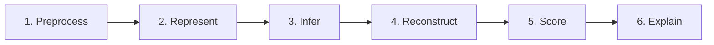

<div align="center">

# GenoFold

```
  NGS · Hi-C · Metadata
         ╲   │   ╱
          ╲  │  ╱
      ┌─────────────┐
      │   GenoFold  │
      └─────────────┘
            │
     3D structure · confidence · insight
```

*Folding fragmented genomic data into structure you can read, trust, and explain.*

<br/>

**A confidence-aware, explainable, multi-modal AI framework**  
for reconstructing three-dimensional genome architecture

<br/>

**Ram Suhrut Seelamankalugari** (SYALIS) · **Quang Bui** (Synthica)

<br/>

[](LICENSE)

</div>

---

## Overview

GenoFold is a research project developing an AI-driven, end-to-end pipeline for reconstructing three-dimensional genome architecture. By integrating Hi-C contact data, next-generation sequencing (NGS) reads, and genomic metadata across numerous species, GenoFold aims to improve the accuracy, robustness, and interpretability of 3D genome models compared with existing computational approaches.

---

## Research Question

> How can a confidence-aware, explainable, multi-modal AI framework integrating Hi-C, NGS, and genomic metadata of numerous species improve the accuracy, robustness, and interpretability of 3D genome reconstruction compared with existing approaches?

---

## Problem Statement

Current computational methods for 3D genome construction face several limitations:

| Challenge | Description |
|-----------|-------------|
| **Data constraints** | Heavy reliance on distance conversion and sensitivity to noise or resolution limits in Hi-C contact matrices |
| **Interpretability** | Models often function as black boxes, failing to integrate raw sequencing features or provide confidence-aware outputs |
| **Fragmentation** | Pipelines are disjointed, requiring multiple independent tools for preprocessing, assembly, and inference—reducing efficiency and reproducibility |

---

## Core Contributions & Novelty

GenoFold addresses these gaps through four key innovations:

### Multi-Modal Integration
Combines NGS reads, Hi-C interaction matrices, and genomic metadata rather than relying on Hi-C contact maps alone.

### AI-Enhanced Processing
Utilizes neural networks, transformer-based models, and autoencoders to clean sparse or noisy data and capture long-range genomic dependencies.

### Confidence & Transparency
Outputs reliability scores and uncertainty estimates, with explainable insights such as feature-importance heatmaps—making models transparent for biomedical and clinical applications.

### Unified Pipeline
Handles preprocessing, inference, scoring, and interpretability within a single, cohesive framework.

---

## Research Pipeline

GenoFold follows a six-stage end-to-end workflow:



| Stage | Description |
|-------|-------------|
| **1. Preprocess** | Filter, correct, align, normalize, and denoise raw NGS and Hi-C data |
| **2. Represent** | Convert genomic interactions into graphs and generate sequence embeddings |
| **3. Infer** | Apply GNN encoders and transformer attention to capture relationships and predict early 3D representations |
| **4. Reconstruct** | Decode learned features into 3D coordinates, spatial distances, and structural domains |
| **5. Score** | Estimate prediction reliability and uncertainty on a per-region basis |
| **6. Explain** | Generate heatmaps and summaries highlighting influential loci and structural importance |

---

## Benchmark Comparisons

GenoFold will be evaluated against established methods across complementary dimensions:

| Method | Evaluation Focus |
|--------|-------------------|
| [**HiC-GNN**](pubmed.ncbi.nlm.nih) | Graph learning and cross-dataset transfer capabilities |
| [**FLAMINGO**](https://www.nature.com/articles/s41467-022-30270-2) | Robustness to sparse data and high-resolution reconstruction |
| [**3DMax**](https://github.com/BDM-Lab/3DMax) | Classic maximum-likelihood, distance-based baseline |

---

## Authors

| Name | Affiliation |
|------|-------------|
| **Ram Suhrut Seelamankalugari** | SYALIS |
| **Quang Bui** | Synthica |

---

## License

This project is licensed under the [MIT License](LICENSE).

---

## Citation

*Citation information will be added upon publication.*
