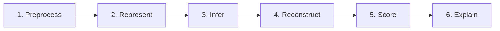

<div align="center">

# GenoFold

```
  NGS · Hi-C · Metadata
         ╲   │   ╱
          ╲  │  ╱
      ┌─────────────┐
      │   GenoFold  │
      └─────────────┘
            │
     3D structure · confidence · insight
```

*Folding fragmented genomic data into structure you can read, trust, and explain.*

<br/>

**A confidence-aware, explainable, multi-modal AI framework**  
for reconstructing three-dimensional genome architecture

<br/>

**Ram Suhrut Seelamankalugari** (SYALIS) · **Quang Bui** (Synthica)

<br/>

[](LICENSE)

</div>

---

## Overview

GenoFold is an AI-driven, end-to-end pipeline for reconstructing three-dimensional genome architecture. It integrates Hi-C contact data, per-bin sequencing coverage, sequence composition, and genomic metadata (real GC content and mappability), and reconstructs chromatin structure through a single six-stage pipeline built on a GATv2 graph encoder and a Transformer.

The network is **trained** end-to-end with a self-supervised distance-matching objective and **benchmarked** on real Rao et al. in-situ Hi-C from three human cell lines (GM12878, IMR90, K562). On GM12878 chromosome 22 it reaches a distance Spearman correlation (dSCC) on par with 3DMax, HiC-GNN, FLAMINGO-style, and ShRec3D, while uniquely adding calibrated per-bin uncertainty, cross-cell-line transfer without retraining, and Integrated-Gradients modality attribution, and scaling to whole chromosomes at 25–50 kb on commodity CPU. See [`paper/GenoFold_BIBM26.pdf`](paper/GenoFold_BIBM26.pdf) for the full study.

---

## Research Question

> How can a confidence-aware, explainable, multi-modal AI framework integrating Hi-C, NGS, and genomic metadata of numerous species improve the accuracy, robustness, and interpretability of 3D genome reconstruction compared with existing approaches?

---

## Problem Statement

Current computational methods for 3D genome construction face several limitations:

| Challenge | Description |
|-----------|-------------|
| **Data constraints** | Heavy reliance on distance conversion and sensitivity to noise or resolution limits in Hi-C contact matrices |
| **Interpretability** | Models often function as black boxes, failing to integrate raw sequencing features or provide confidence-aware outputs |
| **Fragmentation** | Pipelines are disjointed, requiring multiple independent tools for preprocessing, assembly, and inference—reducing efficiency and reproducibility |

---

## Core Contributions & Novelty

GenoFold addresses these gaps through four key innovations:

### Multi-Modal Integration
Combines NGS reads, Hi-C interaction matrices, and genomic metadata rather than relying on Hi-C contact maps alone.

### AI-Enhanced Processing
Utilizes neural networks, transformer-based models, and autoencoders to clean sparse or noisy data and capture long-range genomic dependencies.

### Confidence & Transparency
Outputs reliability scores and uncertainty estimates, with explainable insights such as feature-importance heatmaps—making models transparent for biomedical and clinical applications.

### Unified Pipeline
Handles preprocessing, inference, scoring, and interpretability within a single, cohesive framework.

---

## Research Pipeline

GenoFold follows a six-stage end-to-end workflow:



| Stage | Description |
|-------|-------------|
| **1. Preprocess** | Filter, correct, align, normalize, and denoise raw NGS and Hi-C data |
| **2. Represent** | Convert genomic interactions into graphs and generate sequence embeddings |
| **3. Infer** | Apply GNN encoders and transformer attention to capture relationships and predict early 3D representations |
| **4. Reconstruct** | Decode learned features into 3D coordinates, spatial distances, and structural domains |
| **5. Score** | Estimate prediction reliability and uncertainty on a per-region basis |
| **6. Explain** | Generate heatmaps and summaries highlighting influential loci and structural importance |

---

## Benchmark Comparisons

GenoFold is evaluated head-to-head against established methods on the same real GM12878 contact matrix, using distance Spearman correlation (dSCC) and TAD-boundary reproducibility:

| Method | Role |
|--------|------|
| [**3DMax**](https://github.com/BDM-Lab/3DMax) | Gradient-based maximum-likelihood distance optimizer |
| [**HiC-GNN**](https://doi.org/10.1016/j.csbj.2022.07.007) | Graph convolutional network on Laplacian-eigenmap features |
| [**ShRec3D**](https://www.nature.com/articles/nmeth.3104) | Shortest-path distance completion + classical MDS |
| [**FLAMINGO**](https://www.nature.com/articles/s41467-022-30270-2) | Multi-scale domain reconstruction — **the real published `FLAMINGOr` R package** |

3DMax, HiC-GNN and ShRec3D are re-implemented in one framework (`genofold_pipeline/experiments/baselines.py`) so they consume the identical valid-bin contact matrix. FLAMINGO is run from its actual published R package on the same contacts (`flamingo_run/run_flamingo_chr22.R`) and scored by the same metric (`experiments/flamingo_real.py`). Note FLAMINGO is built for 1–5 kb resolution; run at 50 kb its short-range (≤1 Mb) dSCC is competitive (~0.51) but its coarse inter-domain backbone lowers global all-pair dSCC — see the paper for the honest comparison.

---

## Reproducing the Experiments

The full empirical study (training, benchmarking, ablation, cross-cell-line transfer, uncertainty calibration, scaling) runs from real public data with no manual downloads:

```bash
cd genofold_pipeline
pip install -r ../requirements.txt hic-straw pyBigWig
GENOFOLD_DEVICE=cpu python -m experiments.run_experiments   # ~1 h on CPU
python -m experiments.make_tables      # LaTeX tables -> paper/tables/
python -m experiments.make_figures     # figures      -> paper/figures/
```

Real inputs are streamed and cached automatically: Hi-C from the Rao et al. `.hic` files (GSE63525), the ENCODE/CRG hg19 mappability track, and the hg19 reference sequence. Each experiment module has a runnable self-check (`python -m experiments.<module>`).

---

## Authors

| Name | Affiliation |
|------|-------------|
| **Ram Suhrut Seelamankalugari** | SYALIS |
| **Quang Bui** | Synthica |

---

## License

This project is licensed under the [MIT License](LICENSE).

---

## Citation

*Citation information will be added upon publication.*
